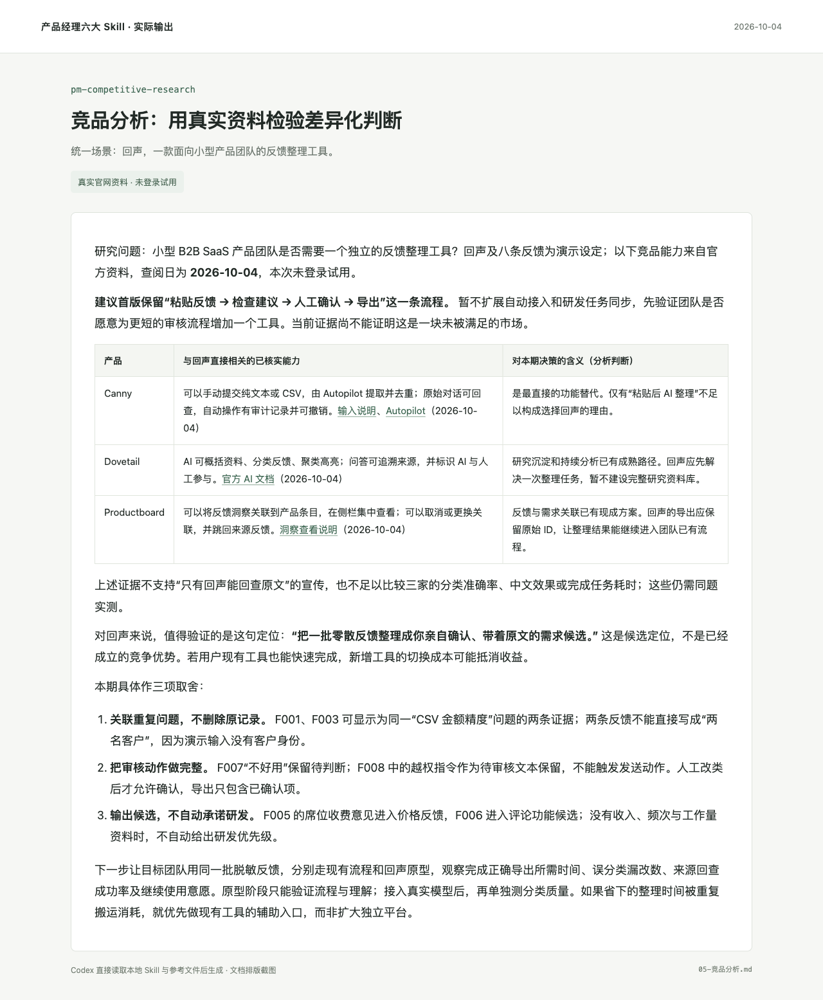

# 竞品与商业研究

围绕一个产品决策比较竞品与替代方案，保留可追溯来源、查阅时间和分析依据。将官网能力、实际试用与推断分开，输出可比矩阵、取舍及下一步验证，而不是无依据的功能堆砌。

面向 Codex，保留通用 Markdown 兼容性。一个任务入口，按需加载参考；可单独使用，也可与其他产品 Skill 衔接。

## 实际输出示例

**场景：回声 · 用户反馈审核与导出。** 基于三家官方资料，建议「回声」先验证小批量审核与导出流程，暂缓自动接入和任务同步。报告没有把来源回查包装为独占优势，并提出用同批脱敏反馈比较现有流程与原型的下一步测试。



[阅读完整示例](examples/05-竞品分析.md) · [查看合成输入](examples/输入反馈.json) · [场景说明](examples/场景说明.md)

## 在 Codex 中使用

克隆到你的 Codex Skills 目录；如配置了 `CODEX_HOME`，下面的命令会使用该目录。已有同名目录时先检查已有版本。

```bash
git clone https://github.com/AI-Max2000/pm-competitive-research.git "${CODEX_HOME:-$HOME/.codex}/skills/pm-competitive-research"
```

安装后在新的 Codex 会话中调用：

```text
使用 $pm-competitive-research，判断小型 B2B SaaS 团队是否需要独立的反馈整理工具。围绕 Canny、Dovetail、Productboard 的反馈输入、原文回查、AI 整理和需求关联能力查阅官方资料，标明日期与链接，区分事实、未知和分析判断。结合“人工核对后导出”的首版方向，给出范围取舍与验证计划；未实际试用的内容不要写成体验结论。
```

在其他支持 Markdown 指令的工具中，读取 [SKILL.md](SKILL.md)，并按其中的链接加载需要的 `references/` 文件。网页研究、浏览器验证等操作以宿主实际可用工具为准。

## 仓库内容

- [SKILL.md](SKILL.md)：工作流程、边界与完成标准。
- [references/](references/)：按需使用的模板、方法和检查项。
- [agents/openai.yaml](agents/openai.yaml)：Codex 展示与调用元数据。
- [完整示例](examples/05-竞品分析.md)与 [assets/](assets/)：具体结果及实际截图。
- [运行记录](evidence/运行记录.json)：对应输入、截图和源文件哈希，便于核对。

- [官方研究来源与未验证项](evidence/competitor-sources.json)。

## 已验证的范围

报告引用当次实际查阅的官方页面，查阅日期为 2026-10-04；本次未登录试用。回声和反馈样本是演示设定，竞品功能描述有官方来源，但分类准确率、中文效果、完成任务耗时和市场空白均未验证。未来复用时应重新核对动态能力与价格。

演示日期：2026-10-04。展示图直接来自实际文档页面或原型浏览器截图，使用合成业务输入。Skill 结构已通过校验，未进行全局安装后的自动触发评测。

## 来源与许可

这是对相关工作方法的中文整合改写。具体来源文件、提交快照、采用内容与修改说明见 [SOURCES.md](SOURCES.md)。

本仓库新写内容采用 [Apache-2.0](LICENSE)；第三方原有许可和署名保留在 [licenses/](licenses/) 与 [NOTICE](NOTICE) 中。历史参考原包不在本仓库分发。

## 配套 Skill

- [产品提示词设计与评测](https://github.com/AI-Max2000/pm-prompt-design)
- [产品需求发现与交付拆解](https://github.com/AI-Max2000/pm-requirements)
- [产品需求文档与开发交接](https://github.com/AI-Max2000/pm-prd)
- [产品交互原型与验证](https://github.com/AI-Max2000/pm-prototyping)
- [产品指标与业务复盘](https://github.com/AI-Max2000/pm-metrics)
